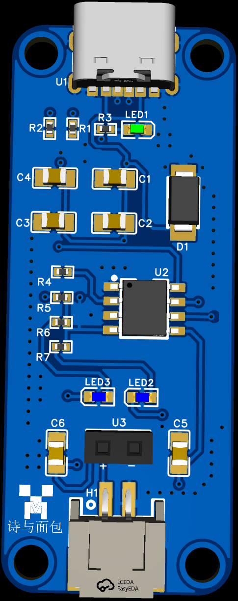
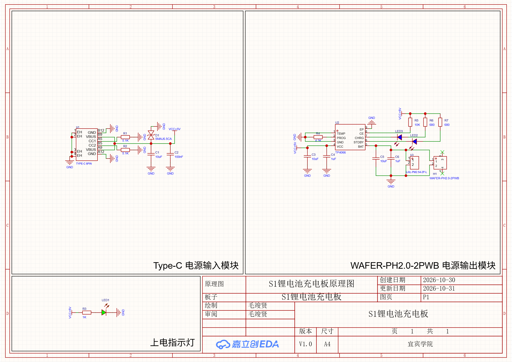
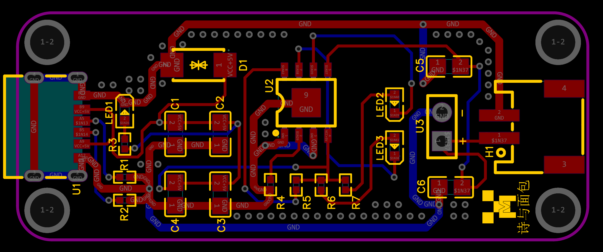

# S1 锂电池充电板

基于 TP4066 的单节锂电池线性充电板：5V Type-C 取电，PH2.0 与 2.54 mm 排针输出，带电源与充电状态指示。纯硬件设计，无 MCU。








## 项目简介

作者学习 PCB 绘制的第一个练手项目，顺便学习一下 PCB 是如何在 Git 上开源的，也是一块可独立使用的单节锂电池充电小板。Type-C 接口只取电不传数据，输入经 TVS 与滤波后送入 TP4066 线性充电 IC，电池侧使用 PH2.0 卧贴座，并保留一组 2.54 mm 排针便于接负载或引出。

## 主要特性

- Type-C 6Pin 输入，CC1 / CC2 各 5.1 kΩ 下拉，作为 5V sink 取电
- 输入保护：SMAJ6.5CA 双向 TVS + 10 µF / 1 µF / 100 nF 退耦
- 充电管理：TP4066（ESOP-8），充电电流由 PROG 电阻 R4 = 4.3 kΩ 设定，具体电流值以 TP4066 数据手册公式为准
- 输出接口：WAFER-PH2.0-2PWB 卧贴座 + 2.54 mm 2P 排针
- 指示：LED1 绿色（5V 电源指示，R3 = 1 kΩ）；LED2 / LED3 蓝色（CHRG / STDBY 充电与充满状态，R6 / R7 = 680 Ω）
- 双面板，板尺寸 50 × 20 mm，四角 R3 圆角

## 关键规格

| 项目 | 说明 |
| --- | --- |
| 输入 | USB Type-C 6Pin，5V，仅供电 |
| 充电 IC | TP4066，ESOP-8，线性充电 |
| 电池 | 单节 4.2V 锂电池 |
| 电池接口 | PH2.0-2P 卧贴座（H1）、2.54 mm 2P 排针（U3） |
| 输入保护 | SMAJ6.5CA 双向 TVS（D1） |
| 板层 / 尺寸 | 2 层 / 50 × 20 mm |
| 设计工具 | 立创EDA专业版 V4.1.60 |

## BOM 摘要

| 位号 | 器件 | 封装 | 数量 |
| --- | --- | --- | --- |
| U1 | Type-C 6Pin 母座（首韩） | USB-SMD_TYPE-C-6PIN | 1 |
| U2 | TP4066（华轩阳） | ESOP-8 | 1 |
| D1 | SMAJ6.5CA（宏嘉诚） | SMA | 1 |
| H1 | WAFER-PH2.0-2PWB（讯普） | SMD 卧贴 | 1 |
| U3 | LAIL-PM2.54-2P-L（莱联） | HDR-TH_2P-P2.54-V-F | 1 |
| R1, R2 | 5.1 kΩ | R0402 | 2 |
| R3 | 1 kΩ | R0402 | 1 |
| R4 | 4.3 kΩ | R0402 | 1 |
| R5 | 10 kΩ | R0402 | 1 |
| R6, R7 | 680 Ω | R0402 | 2 |
| C1, C3, C5 | 10 µF | C0805 | 3 |
| C2 | 100 nF | C0805 | 1 |
| C4, C6 | 1 µF | C0805 | 2 |
| LED1 | 绿色 LED | LED_0603 | 1 |
| LED2, LED3 | 蓝色 LED | LED_0603 | 2 |

完整 BOM（含立创商城编号、制造商信息）见 [BOM.csv](hardware/manufacturing/bom/BOM.csv)。阻容与 LED 未填供应商编号，可按上表规格与封装自行选型。

## 目录结构

```
S1_Lithium_Battery_Charger/
├── README.md
├── LICENSE                       # 许可证全文（CERN-OHL-P v2）
├── hardware/
│   ├── lceda/                    # 立创EDA工程源文件（待补充，见下文）
│   └── manufacturing/            # 制造文件
│       ├── gerbers/Gerber.zip    # Gerber + 钻孔（打包，可直接下单）
│       └── bom/BOM.csv           # 物料清单
├── docs/                         # 详细文档（预留）
├── gallery/                      # 原理图、PCB 与 3D 渲染图
└── mechanical/                   # 机械结构（本板无，预留）
```

## 制造与装配

1. 下载 [Gerber.zip](hardware/manufacturing/gerbers/Gerber.zip)，压缩包内已包含全部走线层、丝印、阻焊、板框、2 个钻孔文件（PTH 与 PTH-Via）以及飞针测试文件，可直接在嘉立创 / JLCPCB 下单，板尺寸自动识别为 50 × 20 mm，2 层板。
2. 配单：参考 [BOM.csv](hardware/manufacturing/bom/BOM.csv)，U1、U2、D1、H1、U3 已带 LCSC 编号，可直接复制到立创商城购物车。
3. 焊接顺序建议：先贴 Type-C 与阻容、LED，再焊 TP4066（底部为 ESOP-8 散热焊盘，注意回流焊盘吃锡量），最后焊 PH2.0 与 2.54 排针。
4. 上电前检查：5V 与 GND 无短路；电池正负极与丝印 `+` / `-` 对应；TVS 为双向，无需区分极性。

## 源文件说明

原理图与 PCB 使用立创EDA专业版绘制。当前仓库只发布 Gerber 与 BOM，源工程待导出后放入 `hardware/lceda/`：

- 立创EDA专业版：导出工程包（`.epro`）或提供在线工程链接，放入 / 写入 README 链接
- 补充前，复现者可按 `hardware/manufacturing/` 中的文件直接生产

## 版本

| 版本 | 日期 | 说明 |
| --- | --- | --- |
| V1.0 | 2026-10-31 | 首版原理图与 PCB，Gerber 于 2026-11-01 导出 |

首版设计尚未完成实物验证，打样后请自行核对充电电流与温升。

## 许可证

本项目采用 **CERN Open Hardware Licence Version 2 - Permissive (CERN-OHL-P v2)**：允许自由使用、修改、制造与再分发，包括用于闭源商业产品，只需保留版权声明。完整条款见 [LICENSE](LICENSE)。

```
Copyright (c) 2026 毛竣贤
```
